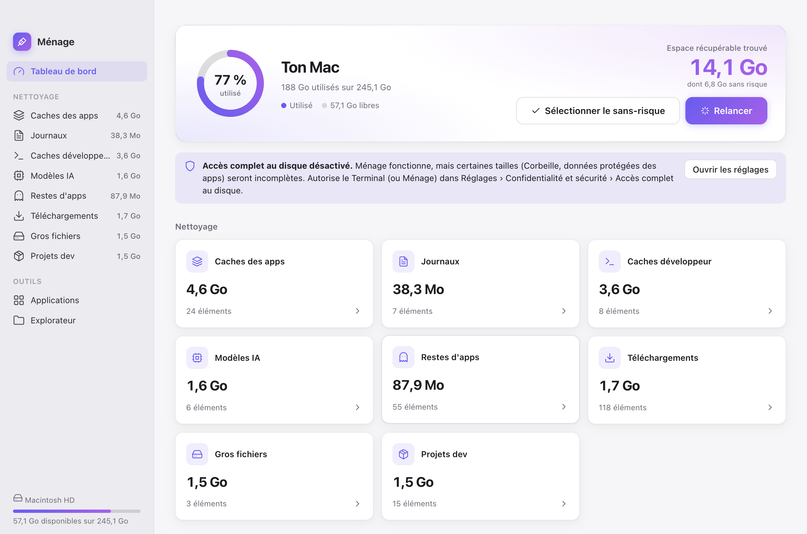

# cleanTonMac

**Ménage** est un tableau de bord pour macOS, dans l'esprit de CleanMyMac, qui repère les caches, les restes d'applications désinstallées et les fichiers oubliés qui encombrent ton disque, puis t'aide à les supprimer **sans risque** : tout part dans la Corbeille.



- **Gratuit et local** : aucune donnée ne quitte ton Mac, aucun compte, aucune télémétrie.
- **Transparent** : chaque élément affiche son chemin exact, sa taille et sa date de modification. Un clic l'ouvre dans le Finder.
- **Réversible** : rien n'est supprimé définitivement tant que tu ne vides pas la Corbeille.

---

## Sommaire

- [Installation](#installation)
- [Utilisation](#utilisation)
- [Ce que Ménage analyse](#ce-que-ménage-analyse)
- [Comment ça fonctionne](#comment-ça-fonctionne)
- [Sécurité](#sécurité)
- [Autorisations macOS](#autorisations-macos)
- [Structure du projet](#structure-du-projet)
- [Développement](#développement)
- [Limites connues](#limites-connues)

---

## Installation

### Prérequis

- **macOS** (testé sur macOS 15 Sequoia, Apple Silicon)
- **Node.js 18 ou plus récent** avec npm : `brew install node` ou [nodejs.org](https://nodejs.org)
- **git**

### Étapes

```bash
git clone https://github.com/martinbaumg/cleanTonMac.git
cd cleanTonMac
npm install
npm start
```

`npm install` télécharge Electron (environ 100 Mo). Il n'est à faire qu'une fois.
Ensuite, `npm start` suffit pour relancer l'application.

---

## Utilisation

### 1. Analyser

Au lancement, Ménage analyse automatiquement ton Mac, en quelques secondes. Le **tableau de bord** affiche :

- l'occupation du disque,
- l'**espace récupérable** total, et la part « sans risque »,
- une carte par catégorie avec sa taille. Clique dessus pour voir le détail.

Le bouton **Relancer** refait une analyse complète. Chaque catégorie peut aussi être réanalysée séparément.

### 2. Choisir

Dans chaque catégorie, les éléments sont triés du plus gros au plus petit. Coche ceux à supprimer : un clic n'importe où sur la ligne suffit.

Les **étiquettes** t'aident à décider :

| Étiquette | Signification |
|---|---|
| 🟢 **Sans risque** | Recréé automatiquement par l'app ou l'outil concerné (cache, log…) |
| 🟣 **App désinstallée** | Appartient probablement à une application qui n'est plus sur ton Mac |
| 🟣 **Programme introuvable** | Agent de démarrage qui lance un programme supprimé |
| 🟠 **Utilisé récemment** | Modifié ces derniers jours : sans doute encore utile, vérifie avant |
| ⚪ **Ancien** / **Projet inactif** | Pas touché depuis longtemps |
| 🔵 **Installateur** | `.dmg` / `.pkg` qui ne sert plus une fois l'app installée |

Raccourcis utiles :

- **Sélectionner le sans-risque** (tableau de bord) coche d'un coup tous les éléments sûrs de toutes les catégories.
- **Filtrer…** cherche dans les noms et chemins.
- Les en-têtes de colonne **Nom / Modifié / Taille** servent à trier.
- L'icône 🔍 affiche l'élément dans le Finder, et l'icône 📁 l'ouvre dans l'explorateur.

La sélection est partagée entre toutes les vues. La barre du bas affiche le total sélectionné, sans compter deux fois un fichier contenu dans un dossier déjà sélectionné.

### 3. Supprimer

**Mettre à la corbeille** affiche un récapitulatif, puis déplace les éléments dans la Corbeille de macOS.

> ⚠️ L'espace n'est réellement libéré qu'une fois la Corbeille vidée. Utilise le bouton **Vider** de la carte « Corbeille » ou le Finder.

### Désinstaller une application

Vue **Applications** : liste de tes apps avec leur taille et leur date de dernière utilisation (tri possible par « les moins utilisées d'abord »).
**Désinstaller…** retrouve l'app **et tous ses fichiers associés** : Application Support, caches, préférences, conteneurs, cookies, agents de démarrage… Tu choisis ce que tu supprimes. Ainsi, aucune donnée ne reste derrière, contrairement à un simple glisser-déposer dans la Corbeille.

### Explorer

Vue **Explorateur** : parcours ton dossier personnel, trié par taille, pour trouver ce qui prend de la place.
La taille des dossiers se calcule progressivement. Des raccourcis mènent à la Bibliothèque, aux Caches, à `~/.cache`, etc.

---

## Ce que Ménage analyse

| Catégorie | Emplacements | Risque |
|---|---|---|
| **Caches des apps** | `~/Library/Caches/*` (hors Apple) | Sans risque |
| **Journaux** | `~/Library/Logs/*`, rapports de plantage | Sans risque |
| **Caches développeur** | npm, npx, pip, uv, Yarn, pnpm, Bun, Gradle, Maven, Cargo, Go, CocoaPods, conda, Xcode (DerivedData, DeviceSupport, archives), simulateurs iOS, émulateurs Android, autres `~/.cache/*` | Sans risque (sauf archives et simulateurs : à vérifier) |
| **Modèles IA** | Hugging Face (`~/.cache/huggingface`), Ollama, LM Studio, PyTorch Hub, Whisper, GPT4All, Keras, InsightFace, rembg… | À vérifier : re-téléchargés si une app en a besoin |
| **Restes d'apps** | Application Support, Containers, Group Containers, Preferences, Saved Application State, HTTPStorages, WebKit, Cookies, Application Scripts, LaunchAgents | À vérifier |
| **Téléchargements** | `~/Downloads` | Installateurs : sans risque. Le reste : à vérifier |
| **Gros fichiers** | Fichiers de plus de 200 Mo dans ton dossier personnel | À vérifier |
| **Projets dev** | `node_modules`, `.venv`/`venv`, `target` (Rust), `Pods`, `.next`, `.turbo`, `.parcel-cache`, `.gradle` | Sans risque si le projet est inactif depuis 30 jours |

---

## Comment ça fonctionne

### Architecture

Ménage est une application [Electron](https://www.electronjs.org/) sans framework ni bundler, en trois couches :

```
┌────────────────────────┐   IPC (contextBridge)   ┌──────────────────────────┐
│ renderer/  (interface) │ ──────────────────────▶ │ main.js  (processus      │
│ HTML + CSS + JS natif  │ ◀────────────────────── │ principal + garde-fous)  │
└────────────────────────┘                         └────────────┬─────────────┘
                                                                │
                                                   ┌────────────▼─────────────┐
                                                   │ src/scanner.js           │
                                                   │ analyses (Node.js pur,   │
                                                   │ du, find, plutil, mdls)  │
                                                   └──────────────────────────┘
```

- **`src/scanner.js`**, le moteur d'analyse, ne dépend pas d'Electron. Il s'appuie sur les outils natifs de macOS :
  - `du -sk` pour la taille réelle occupée sur le disque (6 calculs en parallèle au maximum, pour ne pas saturer le disque),
  - `find` pour les gros fichiers et les dossiers de projets, sans jamais descendre dans `~/Library`, `.git` ni les paquets macOS (`.app`, `.photoslibrary`…),
  - `plutil` pour lire les `Info.plist` des apps et les agents de démarrage,
  - `mdls` pour la date de dernière utilisation d'une app (Spotlight),
  - `codesign` pour l'identifiant d'équipe des développeurs (Group Containers).
- **`main.js`** expose ces fonctions à l'interface via IPC. C'est lui qui effectue les suppressions, avec `shell.trashItem`, après les vérifications de sécurité.
- **`renderer/`** est l'interface, isolée : `contextIsolation`, `sandbox` et une Content-Security-Policy stricte. Elle n'a aucun accès direct au système de fichiers.

### Détection des restes d'applications

C'est la partie la plus délicate. Ménage construit d'abord un **index de ce qui est installé** :

1. toutes les apps de `/Applications`, `~/Applications` et `/System/Applications`, avec leur identifiant (`com.editeur.app`), leur nom, leur exécutable et leur éditeur,
2. les identifiants d'équipe de signature des apps tierces,
3. les processus en cours d'exécution,
4. les commandes installées (`PATH`, Homebrew, nvm, cargo…).

Chaque dossier de la Bibliothèque est ensuite comparé à cet index :

- s'il porte un **identifiant** (`com.voicestudio.desktop`), Ménage cherche une app au même identifiant, ou au même préfixe, ou du même éditeur,
- s'il porte un **nom** (`VoiceStudio`), Ménage cherche une app, une commande ou un processus au nom proche,
- les éléments d'Apple et du système sont toujours ignorés,
- pour un agent de démarrage (`LaunchAgents`), Ménage vérifie si le programme qu'il lance existe encore.

Tout ce qui ne correspond à rien est proposé comme **reste d'app**. La détection est volontairement prudente : dans le doute, un élément est considéré comme installé. Une détection automatique reste toutefois une supposition. Vérifie donc les lignes, surtout celles marquées « Utilisé récemment ».

### Modèles IA

Les modèles Hugging Face sont listés un par un (`organisation/modèle`). Quand un fichier marqueur l'indique, Ménage affiche l'application qui a téléchargé le modèle.
Si ton cache utilise le dossier `blobs` partagé, les fichiers réels y sont stockés. Ménage le signale : supprimer un modèle sans ce dossier ne libère pas l'espace.

---

## Sécurité

La suppression est encadrée côté processus principal, indépendamment de l'interface :

- **Corbeille uniquement.** Tout passe par `shell.trashItem`, la même fonction que « Placer dans la corbeille » du Finder. Aucune suppression définitive, sauf si tu vides la Corbeille toi-même.
- **Liste blanche.** Seuls les chemins renvoyés par une analyse ou l'explorateur pendant la session peuvent être supprimés. L'interface ne peut pas envoyer un chemin arbitraire.
- **Périmètre limité.** Rien en dehors de ton dossier personnel, à l'exception des apps de `/Applications`.
- **Dossiers protégés.** Les dossiers suivants ne peuvent jamais être supprimés :
  - ton dossier personnel, `~/Library` et ses dossiers principaux,
  - Documents, Bureau, Téléchargements, Images, Musique, Vidéos,
  - `~/.ssh`, `~/.gnupg`, les trousseaux, tes fichiers de configuration de shell,
  - le dossier de Ménage lui-même.
- **Pas de doublons.** Si un dossier et un fichier qu'il contient sont tous deux sélectionnés, seul le dossier est traité.
- **Pas d'accès réseau.** L'application ne se connecte à rien.

---

## Autorisations macOS

- **Accès complet au disque** (recommandé). Sans lui, certaines tailles restent incomplètes : Corbeille, conteneurs d'apps protégés. Ouvre Réglages Système › Confidentialité et sécurité › **Accès complet au disque**, puis autorise **Terminal**, ou l'app depuis laquelle tu lances `npm start`. Le tableau de bord propose un bouton qui ouvre directement ce réglage.
- **Dossiers Documents / Bureau / Téléchargements.** macOS peut demander l'autorisation lors de la première analyse.
- **Contrôle du Finder.** Il est demandé la première fois que tu cliques sur « Vider la corbeille ».

---

## Structure du projet

```
cleanTonMac/
├── main.js              # Processus principal Electron : fenêtre, IPC, garde-fous de suppression
├── src/
│   ├── scanner.js       # Moteur d'analyse (Node.js pur, testable sans Electron)
│   └── preload.js       # Pont sécurisé entre l'interface et le processus principal
├── renderer/
│   ├── index.html       # Structure de la fenêtre
│   ├── styles.css       # Thème clair/sombre automatique
│   └── app.js           # Vues, sélection, modales
└── docs/                # Captures d'écran
```

---

## Développement

Tester le moteur d'analyse sans interface :

```bash
node -e "require('./src/scanner').scan('caches').then(r => console.table(r.slice(0, 10).map(i => ({ nom: i.label || i.name, Mo: Math.round(i.size / 1e6) }))))"
```

Catégories disponibles : `caches`, `logs`, `dev`, `ai`, `orphans`, `downloads`, `large`, `projects`.

Capturer l'interface automatiquement (pratique pour vérifier un changement) :

```bash
MENAGE_SNAPSHOT=capture.png MENAGE_WAIT=8000 npx electron .
# Avec une action avant la capture :
MENAGE_SNAPSHOT=apps.png MENAGE_EVAL="document.querySelector('[data-view=apps]').click()" npx electron .
```

Pour ajouter un emplacement à analyser, il suffit en général d'ajouter une ligne dans `DEV_PATHS` ou dans la liste `singles` de `scanAI` (`src/scanner.js`).

---

## Limites connues

- **macOS uniquement.** Les chemins et outils utilisés (`mdls`, `plutil`, `codesign`) sont propres à macOS.
- La détection des restes d'apps est **heuristique** : faux positifs possibles pour des outils en ligne de commande ou des dossiers partagés par plusieurs apps du même éditeur.
- Les apps installées par un administrateur (propriété de `root`) ne peuvent pas être mises à la Corbeille sans mot de passe. Ménage te le signale : supprime-les depuis le Finder.
- L'application se lance pour l'instant avec `npm start`. Il n'existe pas encore de `.app` prête à télécharger.
